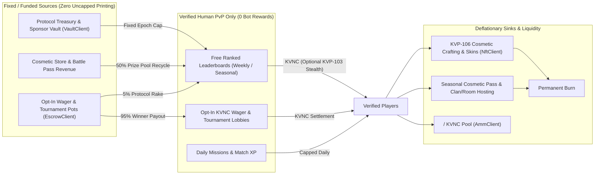

# KOVANICA: FOUNDRY — Game Design Document (GDD)

> [!IMPORTANT]
> **Clean-Slate Redesign:** This document specifies a 100% brand-new 3D browser-based PvP shooter built from scratch for Kovanica Protocol. Zero code, mechanics, or assets are reused from the deprecated Phase 0 prototype. `kovanica-l1` consensus remains strictly untouched (audit-frozen at `80eec39`).

---

## 1. Executive Summary & Design Pillars

**Working Title:** `KOVANICA: FOUNDRY`  
**Genre:** Fast 3D PvP Territory-Control Shooter (WASD + Mouse, stylized Roblox / Krunker / Arsenal feel)  
**Camera:** First-Person (FPS) primary with instant Third-Person (TPS) over-the-shoulder toggle (`V` key)  
**Platform:** Desktop Web-First (Chrome/Edge/Firefox + `window.kovanica` & `wallet-web`; mobile touch/gamepad planned Phase 2)  
**Onboarding:** Play-First Guest Mode (instant 1-click match in `< 3s`) → Optional 1-click Wallet + Wave C Session Key to unlock Ranked `KVNC`, `<GAME_TOKEN>`, and KVP-106 cosmetics  
**Economy:** Dual-Token (`KVNC` + KVP-102 `<GAME_TOKEN>`, final name TBD) — Hybrid Free Ranked Pools + Opt-In Skill Wagers/Tournaments + Cosmetic Sinks  
**Target Mainnet Cutover:** Chain 2 Testnet → Chain 1 Mainnet (Jan 1, 2027)

### Core Design Pillars
1. **Fun First, Wallet Second:** The game must feel crisp, fast, and genuinely replayable as a pure browser shooter even with zero wallet connected.
2. **Tactical Territory Over Blind Fragging:** Holding Foundry Nodes, controlling elevated catwalks, and breaking enemy setups wins matches — pure aim helps, smart map control dominates.
3. **100% Zero Pay-to-Win:** Every weapon, class, and ability is free and stat-identical for all players from Match 1. Tokens and KVP-106 NFTs are strictly cosmetic, prestige, or opt-in competitive stakes.
4. **Zero P2E Death Spiral:** No uncapped token printing. `KVNC` rewards come exclusively from capped seasonal/weekly budgets and player-funded tournament/wager pools; `<GAME_TOKEN>` has hard daily caps and strong cosmetic burn sinks.
5. **Server-Authoritative Integrity:** Clients send inputs; the server simulates movement, validates fire rates and line-of-sight, scores objectives, and signs settlement payloads.

### Explicit Anti-Goals
- No top-down arcade dodger, endless runner, or tap-to-earn clicker mechanics.
- No pay-to-win weapon upgrades, paid stat boosts, or NFT power multipliers.
- No mid-match wallet signing popups or gas prompts.
- No token payouts in bot-backfill or solo practice matches.

---

## 2. Core Gameplay Loop & Controls

### 60-Second Moment-to-Moment Loop
1. **Drop In & Pick Class (2s):** Spawn in the Foundry Arena with 1 of 4 free tactical classes (swappable on any respawn with keys `1–4`).
2. **Push & Contest Nodes (15–30s):** Sprint, jump, and use your class ability across industrial catwalks and cover blocks to contest glowing holographic territory nodes.
3. **Fight & Control (Continuous):** Crisp hitscan/projectile gunplay with tight TTK (~0.6s–1.1s), headshot multipliers, audio/visual hitmarkers, and killfeed callouts.
4. **Score & Adapt (5-Min Match):** Hold nodes to tick team/personal score (or bank harvested cores depending on mode). First to target score or highest at `5:00` wins.
5. **Post-Match Progression (10s):** Instant scoreboard, MVP badge, XP warmup progress, `<GAME_TOKEN>` mission credit (verified human PvP only), and Ranked MMR update → 1-click **Play Again**.

### Controls (Desktop WASD + Mouse)
| Input | Action |
|---|---|
| `W / A / S / D` | Move / Strafe |
| `Mouse` (Pointer Lock) | Aim / Look |
| `Left Click` | Primary Fire |
| `Right Click` | Aim Down Sights (ADS) / Zoom |
| `Space` | Jump (crisp arcade-tactical jump arc) |
| `Shift` | Sprint |
| `E` | Class Tactical Ability (cooldown-based) |
| `R` | Reload |
| `V` | Toggle Camera: **FPS ↔ TPS Over-the-Shoulder** |
| `1 – 4` | Queue Class Swap (applies on next respawn) |
| `Tab` | Live Scoreboard & Node Control Breakdown |
| `Esc` | Pause / Sensitivity / Settings / Wallet Panel |

---

## 3. Multi-Mode Modular Arena Architecture

All modes run on the same modular 3D Foundry Arena engine (`GameMode` state machine plug-in on the authoritative server):

| Mode | Format | Objective & Win Condition | Ranked / KVNC Eligible? |
|---|---|---|---|
| **1. Foundry Domination** *(Flagship)* | 3v3 or 4v4 (Gold vs Teal), `5:00` | 3 static territory nodes (**Alpha**, **Beta**, **Gamma**). Holding nodes ticks +1 pt/sec per node (3-cap triggers **Overclock 2×**). First to **400 pts** or highest at `5:00` wins. | Yes (Human-only Ranked & Wager) |
| **2. Vault Rush (KOTH)** | 4–8 Players FFA, `4:00` | Single high-value **Mint Vault** activates for 45s, then rotates to a new arena zone. Standing inside ticks +3 pts/sec; eliminations inside the zone grant +10 bonus pts. Works great even with 2–4 players online. | Yes (Human-only Ranked & Wager) |
| **3. Core Extraction** | 3v3 (Gold vs Teal), `5:00` | Capturing nodes spawns carryable **Energy Cores**. Carry cores back to your team's **Foundry Relay** to bank them; getting eliminated drops 50% of unbanked cores for anyone to steal. | Yes (Human-only Ranked & Wager) |
| **4. Solo / Bot Warmup** | 1–6 Players + AI Bots | Plays any of the 3 modes above with instant AI bot backfill so players can test classes, practice aim, and play immediately with 0 queue time. | **No (0 KVNC, 0 `<GAME_TOKEN>`)** |

---

## 4. Four Balanced Tactical Classes (100% Free, Zero P2W)

Every player starts with all 4 classes unlocked. Classes are balanced around distinct territory roles and readable blocky 3D silhouettes:

| Class | Role | HP | Speed | Primary Weapon | Tactical Ability (`E`) |
|---|---|---|---|---|---|
| **Striker** | Frontline Capper | 100 | 1.0× | **Foundry AR** — Reliable full-auto pulse rifle, balanced range & recoil | **Vector Dash** — Quick directional burst dash to cross firelanes or dodge onto a node (7s CD) |
| **Breacher** | Close-Quarters Node Breaker | 115 | 1.08× | **Vortex SMG / Scatter** — High fire-rate close-range shredder | **Kinetic Slide / Impulse** — Forward burst + knockback shockwave that pushes enemies off a capture ring (8s CD) |
| **Marksman** | High-Ground Overwatcher | 85 | 0.96× | **GHOSTDAG Rail** — Precision semi-auto beam rifle, high headshot multiplier | **Recon Pulse** — Emits a 4s localized pulse revealing enemies within 22m through walls for your team (12s CD) |
| **Warden** | Anchor / Point Defender | 130 | 0.90× | **Aegis Burst Carbine** — Tight 3-round burst rifle, strong mid-range | **Hardlight Barrier** — Deploys a temporary translucent energy wall (8s duration, 250 HP) to lock down node sightlines (11s CD) |

---

## 5. Art Direction & Arena Design

### Visual Identity: Dark-Tech Tactical × Industrial Mint Foundry
- **Palette (Native Kovanica Design System):**
  - **Arena Architecture:** Matte obsidian & dark zinc (`#09090b`, `#141418`, `#27272a`) concrete/steel monoliths, industrial foundry trusses, recessed floor grids.
  - **Team Gold:** `#F2A900` (warm luminous gold visors, shoulder trim, tracer bolts, captured node holograms).
  - **Team Teal:** `#2fbaa4` (crisp cyber-teal visors, shoulder trim, tracer bolts, captured node holograms).
  - **Neutral / Contested:** Cool white `#e4e4e7` / pulsing amber-red hazard stripes when contested.
- **Stylized Blocky 3D Geometry (Roblox × Krunker Readability):**
  - Clean articulated blocky avatars (head, torso, arms, legs with procedural walk/sprint/recoil animations) so **TPS (`V`)** feels expressive and **KVP-106 cosmetics** (helmets, visors, backpacks, weapon finishes, tracer colors) are instantly visible.
  - Procedural Three.js PBR materials + emissive strips + subtle foundry fog = **locked 60–120 FPS** in standard browsers with sub-2MB initial bundle size.
- **Map 1 (`THE MINT — SECTOR 01`):**
  - Symmetrical 3-lane industrial foundry arena (~72m × 52m) with verticality:
    - **Center Pit (Node Beta):** Sunken mint crucible with 4 ramps and an overhead catwalk bridge (high risk, high reward).
    - **West & East Flanks (Nodes Alpha & Gamma):** Elevated smelting platforms with jump pads, sightline pillars, and flanking ducts.
    - Glowing floor conduits physically connect Nodes Alpha/Beta/Gamma to each team's Foundry Relay and shift color in real time as ownership flips.

---

## 6. Sustainable Dual-Token Economy (`KVNC` + KVP-102 `<GAME_TOKEN>`)



### 1. `KVNC` (Native L1 Coin) — Prestige & Competitive Stakes
- **Free-to-Play Ranked Pools:** Funded by a **strictly fixed** weekly/seasonal budget locked in `VaultClient` (treasury seed + 50% of cosmetic revenue + 5% rake from opt-in wager lobbies). Distributed across ranked tiers (Top 100 / Top 25% of eligible human players) so rewards never outgrow revenue.
- **Opt-In Skill Wagers & Tournaments:** Players can create or join `KVNC`-staked 1v1, 3v3, or 8-team bracket lobbies using Kovanica's native `EscrowClient`. Winner takes **95%** of the escrowed pot; **5%** protocol fee recycles into the Free Ranked pool and `<GAME_TOKEN>` buyback/burn.
- **Zero Treasury Drain Guarantee:** If player count 10×s, per-epoch Ranked `KVNC` remains fixed (higher competition), while wager/cosmetic volume grows the prize pool organically.

### 2. `<GAME_TOKEN>` (KVP-102 Utility Token, Name TBD) — Progression & Cosmetic Sinks
- **Earned By:** Verified human PvP matches (performance + objective score) and daily/weekly missions, subject to a **hard per-account daily emission cap** and **global epoch emission ceiling**.
- **Burned / Spent On (Zero Stat Advantage):**
  - Crafting & minting **KVP-106** weapon skins, blocky avatar armor sets, visors, kill-effect shaders, and custom tracer trails.
  - Upgrading cosmetic rarity tiers (e.g., *Standard → Forged → Obsidian Gold*).
  - Unlocking seasonal cosmetic Battle Pass tracks.
  - Hosting custom community tournaments / private branded foundry rooms.
- **Liquidity:** Tradeable natively via Kovanica's `AmmClient` (`<GAME_TOKEN> / KVNC` pool), with optional atomic approve-and-swap via `buildApproveAndSwapBatchActions`.

---

## 7. Server-Authoritative Anti-Bot & Anti-Cheat Design

Because real `KVNC` is paid out, the client is treated as **100% untrusted**:

1. **Authoritative 20–30 Hz Tick Server (Node.js / TypeScript + WebSockets):**
   - Client sends **input frames only** (`{ seq, moveX, moveZ, yaw, pitch, jump, sprint, fire, ability, cameraMode }`).
   - Server runs canonical movement physics (clamping speed, jump cooldown, collision bounds), weapon fire-rate & ammo checks, and **lag-compensated raycast hit-registration** against server-side player hitboxes and arena geometry.
   - Client runs local prediction + reconciliation for crisp 60–120 FPS feel, never authoritative damage.
2. **Strict Bot-Mode Isolation:**
   - Solo/Bot Warmup matches are flagged `isRewardEligible: false` at room creation and emit **zero** `KVNC` and **zero** `<GAME_TOKEN>`.
3. **Ranked Sybil & Multi-Account Gate:**
   - Requires connected Kovanica wallet + active Wave C Session Key + completion of **XP Warmup** (5 verified human casual matches with non-AFK objective participation).
   - Rate limits per IP/subnet & device fingerprint telemetry for free Ranked pool claims.
4. **Automated Telemetry & Win-Trading Detection:**
   - Server logs per-match stats: aim-snap velocity histograms, headshot ratio outliers, wall-pre-aim anomalies, and **match-graph win-trading** (repeated intentional losses between linked wallets/IPs).
5. **Delayed Epoch Settlement (24h Review Window):**
   - Ranked `KVNC` and `<GAME_TOKEN>` epoch payouts settle after a 24-hour automated anomaly sweep (never instant per-kill payouts). Flagged accounts are frozen and audited before batch distribution.

---

## 8. Kovanica Protocol Integration (`kovanica-sdk v0.10.0`)

| Feature | SDK Primitive / Module | How `KOVANICA: FOUNDRY` Uses It |
|---|---|---|
| **Wallet & Network** | `window.kovanica`, `KovanicaClient`, `KovanicaWsClient`, `CHAIN_IDS` | Play-first Guest mode; 1-click connect to Extension / `wallet-web`. Reads chain ID and switches cleanly between Testnet (Chain 2) and Mainnet (Chain 1). |
| **Zero-Popup Gameplay** | Wave C `SessionKeyPolicy`, `checkSessionPolicy` | Single signature at lobby login grants a scoped, time-bounded Session Key (whitelisted only to Foundry game contracts, strict spend cap) so crafting, claiming, and joining lobbies require zero mid-session popups. |
| **Gasless UX & Atomic Flows** | Wave A `signSponsoredTransaction`, `signBatchTransaction` | Game relayer sponsors gas for free-to-play `<GAME_TOKEN>` claims and cosmetic mints. `signBatchTransaction` executes atomic multi-step actions (e.g., burn `<GAME_TOKEN>` + mint KVP-106 skin in one tx). |
| **Wagers & Tournaments** | `EscrowClient` (`buildEscrowCreateCall`, `EscrowRecord`) | Trustless on-chain `KVNC` escrow for opt-in PvP duels and tournament brackets; server submits signed match attestation to release pot. |
| **Dual Token & Cosmetics** | `TokenClient` (KVP-102), `NftClient` (KVP-106), `AmmClient` | Mint/burn `<GAME_TOKEN>`, mint cosmetic skin NFTs read directly into the Three.js avatar/weapon renderer, and link to native AMM swaps. |
| **Private Payouts** | KVP-103 (`parseStealthMetaAddress`, `deriveOnetimeAddress`) | Optional toggle in Profile Settings allowing Ranked/Tournament `KVNC` winners to receive epoch payouts to a fresh one-time stealth address. |
| **Seasonal Budgets** | `VaultClient` | Transparent on-chain vault holding the fixed weekly/seasonal Ranked `KVNC` prize pool. |

### Testnet (Chain 2) → Mainnet (Chain 1, Jan 1, 2027) Cutover Plan
- **Config-Driven Network Registry:** Single `src/chain/networkConfig.ts` switching RPC (`https://rpc-testnet.kovanica.online/rpc` vs `https://rpc.kovanica.online/rpc`), Chain ID (`2` vs `1`), and deployed contract addresses (`<GAME_TOKEN>`, `FoundryCosmetics KVP-106`, `FoundryEscrow`, `SeasonalVault`).
- **Phase A (Testnet Alpha — Now):** Live playable 3D prototype + authoritative server + Testnet Chain 2 wallet connect, Session Key flow, mock/testnet `<GAME_TOKEN>` & `KVNC` settlement, public playtesting & anti-cheat tuning.
- **Phase B (Testnet Beta — Dec 2026):** Full Wave A gasless relayer, KVP-106 skin minting, opt-in `EscrowClient` tournaments, load testing, and economy parameter freeze.
- **Phase C (Mainnet Genesis — Jan 1, 2027):** Deploy production contracts on Chain 1, fund Season 1 `VaultClient` prize pool, flip `VITE_KOVANICA_CHAIN_ID=1`, zero L1 changes required.

---

## 9. Phase 1 Playable Prototype Scope (Next Step After Approval)

Once you approve this GDD, I will **wipe `/home/antonio/kovanica-protocol/kovanica-game`** and build a clean, immediately playable v1 prototype from scratch:

```text
kovanica-game/
├── shared/                 # Shared physics, map geometry, weapon/class stats, mode rules, WS protocol types
├── server/                 # Authoritative 20Hz Node/TS WebSocket game server (multi-room, hit-reg, AI bot backfill, anti-cheat checks)
├── client/                 # Vite + TypeScript + Three.js 3D shooter (FPS + V TPS toggle, 4 classes, 3 modes, Dark-Tech Foundry arena, HUD, audio)
│   └── src/chain/          # Kovanica wallet adapter (window.kovanica + Guest mode + Wave C Session Key + Testnet/Mainnet config)
├── docs/                   # GDD copy & architecture notes
└── tests/                  # Automated unit tests for authoritative physics, hit-reg, territory scoring, and economy caps
```

### What You Will Be Able to Play Immediately in Phase 1
1. Launch client + authoritative server locally in one command (`npm run dev`).
2. Click **Play as Guest** (or connect `window.kovanica` on Testnet Chain 2) → pick **Foundry Domination**, **Vault Rush (KOTH)**, or **Core Extraction**.
3. Drop into **The Mint — Sector 01** (full 3D Dark-Tech Foundry arena in Three.js) with **WASD + Mouse**, **FPS primary + `V` TPS toggle**, all **4 tactical classes**, live **Gold vs Teal** territory nodes with shifting conduits, AI bot backfill for instant solo testing, AND real multi-tab / LAN WebSocket PvP!
4. Full HUD (health, ammo, ability cooldown, capture rings, minimap/compass, killfeed, scoreboard, post-match rewards preview).

---

> [!NOTE]
> **Ready for your sign-off!** Please review this GDD and let me know if you want any tweaks to the modes, classes, economy, or Kovanica integration — or say **"Approved"** and I will wipe `kovanica-game` and build the playable Phase 1 prototype of **KOVANICA: FOUNDRY**.
